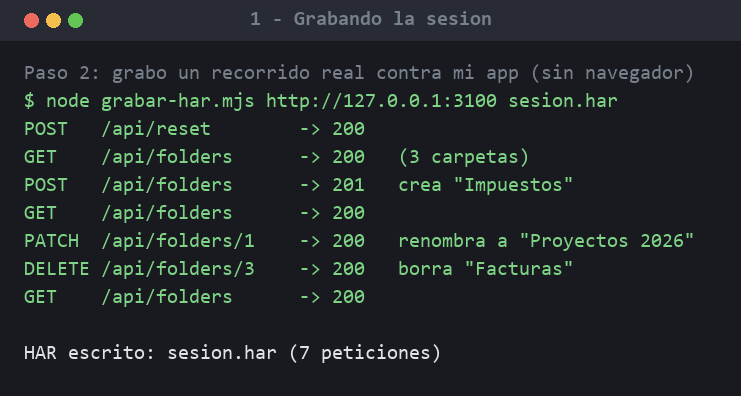
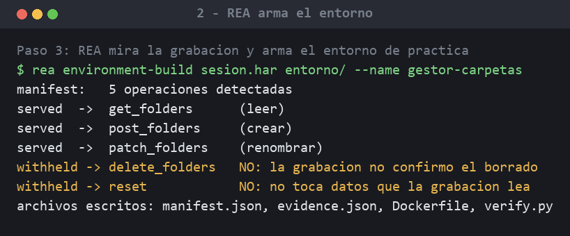
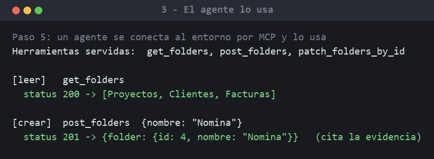
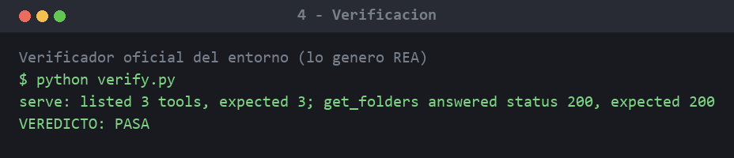

# Entorno de entrenamiento para agentes de IA, a partir de una app web

**Juan Felipe Cabrera Guzmán** — demo técnica · noviembre de 2026

Construí un **entorno de práctica** para entrenar y evaluar agentes de inteligencia
artificial, generándolo automáticamente a partir de una aplicación web, sin escribir
el entorno a mano y sin tocar la app original.

## La idea en una frase

Es como un **simulador de manejo**: en vez de soltar a la IA en el programa real (donde
podría borrar datos), se le da una copia de práctica fiel. Acá esa copia se genera sola,
mirando **una sesión grabada** de uso de la app.

Herramienta usada: [REA (Reverse Engineer Anything)](https://github.com/morluto/rea) +
Ghidra, corriendo de forma local.

## El flujo, en 4 pasos

**1. Grabo un recorrido real sobre una app web propia** (un gestor de carpetas con su API:
listar, crear, renombrar, borrar). La sesión se guarda como un archivo HAR estándar, sin
necesidad de navegador.

**2. REA mira esa grabación y arma el entorno.** Detecta las operaciones y, lo más
importante, **decide qué permitir**. Habilita leer, crear y renombrar; y **retiene a
propósito** borrar y reiniciar, explicando por qué: la grabación no dejó evidencia
suficiente de esos efectos. No emula ni inventa: solo sirve lo que los datos respaldan.

**3. El entorno queda servido por MCP**, el mismo protocolo con el que los agentes hablan
con sus herramientas.

**4. Un agente se conecta y lo usa:** lista las herramientas, lee las carpetas y crea una
nueva, recibiendo respuestas idénticas a las de la app real, con cita a la evidencia.

## Resultado

El verificador que genera el propio REA pasa sin intervención:

## Por qué importa

- **Seguro por diseño:** el agente practica contra una copia; nunca toca el sistema real.
- **Trazable:** cada respuesta cita el registro de evidencia del que sale.
- **Prudente:** la herramienta es explícita sobre lo que *no* puede garantizar, en lugar
  de fingir que lo sabe todo.

Es la misma clase de trabajo (preparar datos y entornos para entrenar IA) que realicé para
Appen.

## Cómo está hecho

| Pieza | Archivo |
|---|---|
| App web de demo (API REST en memoria) | `codigo/app.mjs` |
| Grabador de sesión a HAR (con `fetch`, sin navegador) | `codigo/grabar-har.mjs` |
| Agente de demostración (cliente MCP) | `codigo/agente_demo.py` |
| Verificador del entorno | `codigo/verificar_entorno.py` |

El código completo está en la carpeta `codigo/`.

> Nota: el entorno se sirve con `environment-serve` (lo mostrado aquí). Correrlo dentro del
> framework `agent-env` requiere Docker.
